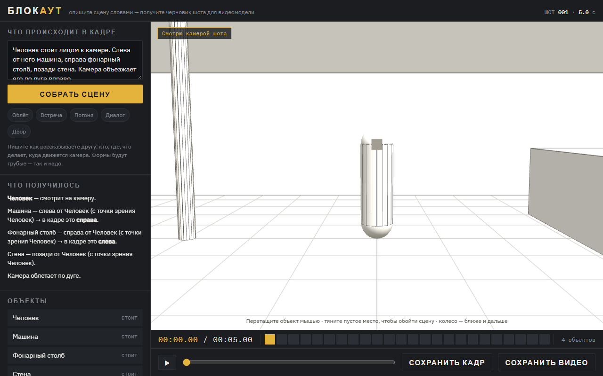

# Blockout

[Русская версия](README.ru.md)

Describe a shot in words and get a rough draft: grey shapes, trajectories and camera movement. The draft is meant to be fed to a video model as a structural reference. It runs in the browser, including on a phone, with no Blender and no install. The interface is in Russian.



**[Open Blockout](https://antropos17.github.io/blockout/)**

## How it works

A language model turns the description into relations ("the car is to the left of the person, from their point of view"). The coordinates, the reference frame, body separation and the camera arc are computed by `src/solver.js`. The reasoning for that split is in `CLAUDE.md`.

## Features

- Build a scene from a description, adjust it with the mouse, pin an object at a given second
- Switch between the shot camera and a free view, take the camera from the current view
- Export a frame (PNG) or the whole shot (WebM)

## Run

```bash
npm run build      # produces dist/blockout.html
npm test           # solver tests
npm run check      # both
```

No dependencies; Node is enough.

## More

`CLAUDE.md` has context and rules; `docs/DECISIONS.md` lists what is already settled and why.

## Stack

Plain JavaScript, a Node build script, a single HTML output.
